# Roadmap

Visão geral das etapas do Guardiões do Folclore, do protótipo às lojas. Cada etapa vira um **milestone** no GitHub, e cada tarefa vira uma **issue** dentro dele.

**Atualizado em:** 18/10/2026

```mermaid
flowchart LR
    subgraph F["Concluído"]
        direction TB
        v01["v0.1<br/>Protótipo HTML"]:::feito
        v02["v0.2<br/>Torre dos Chefes<br/>e ilustrações"]:::feito
    end
    subgraph A["Em andamento"]
        direction TB
        e1["Etapa 1 · v0.3.0<br/>Fundação em Godot"]:::andamento
    end
    subgraph P["Planejado"]
        direction TB
        e2["Etapa 2 · v0.4.0<br/>Migração do jogo"]:::planejado
        e3["Etapa 3 · v0.5.0<br/>Arte (PixelLab)"]:::planejado
        e4["Etapa 4 · v0.6.0<br/>Som (ElevenLabs e Suno)"]:::planejado
    end
    subgraph X["Futuro"]
        direction TB
        e5["Etapa 5<br/>Contas e segurança<br/>(Roda Online)"]:::futuro
        e6["Etapa 6<br/>Lojas<br/>Android, iOS e Steam"]:::futuro
    end

    v01 --> v02 --> e1 --> e2 --> e3 --> e4 --> e5 --> e6

    classDef feito fill:#2f9a68,stroke:#14532d,color:#ffffff
    classDef andamento fill:#d6a24a,stroke:#7a5420,color:#140d08
    classDef planejado fill:#1d3b31,stroke:#3fae7f,color:#efe7d4
    classDef futuro fill:#1d2733,stroke:#8fc0d4,color:#efe7d4,stroke-dasharray:4 3
```

Legenda: 🟢 concluído · 🟡 em andamento · ⚪ planejado · 🔵 futuro

## Etapas

| | Etapa | Versão | Objetivo | Status | Milestone |
|---|---|---|---|---|---|
| 🟢 | Protótipo | v0.1.0 | Primeira versão jogável em HTML | Concluído | — |
| 🟢 | Torre dos Chefes | v0.2.0 | Ilustrações, chefes até o nível 30, combate animado | Concluído | — |
| 🟡 | **1. Fundação** | v0.3.0 | Godot, núcleo testável, CI com limites, save com migrações, perfis offline/online | Em execução (grupos A–D prontos; falta o teste no celular) | [v0.3.0 · Fundação](https://github.com/AlexGamesProjects/Guardi-es-do-Folclore/milestone/1) |
| ⚪ | 2. Migração | v0.4.0 | Todas as telas e mecânicas no Godot, interface para celular | Planejado | [v0.4.0 · Migração](https://github.com/AlexGamesProjects/Guardi-es-do-Folclore/milestone/2) |
| ⚪ | 3. Arte | v0.5.0 | Sprites animados do PixelLab, cartas pintadas, herói com opções | Planejado | [v0.5.0 · Arte](https://github.com/AlexGamesProjects/Guardi-es-do-Folclore/milestone/3) |
| ⚪ | 4. Som | v0.6.0 | Efeitos, ambientes e narração (ElevenLabs), trilha (Suno) | Planejado | [v0.6.0 · Som](https://github.com/AlexGamesProjects/Guardi-es-do-Folclore/milestone/4) |
| 🔵 | 5. Contas e segurança | a definir | Login, save na nuvem, Roda Online, servidor validando comandos, LGPD | Futuro | [Contas e segurança](https://github.com/AlexGamesProjects/Guardi-es-do-Folclore/milestone/5) |
| 🔵 | 6. Lojas | a definir | Publicação em Android, iOS e Steam | Futuro | [Lojas](https://github.com/AlexGamesProjects/Guardi-es-do-Folclore/milestone/6) |

## O que entra em cada etapa

### 1. Fundação (v0.3.0) · [especificação](superpowers/specs/2026-10-17-fundacao-godot-design.md)
- [x] Especificação aprovada ([#9](https://github.com/AlexGamesProjects/Guardi-es-do-Folclore/issues/9))
- [x] Plano de implementação ([plano](superpowers/plans/2026-10-17-fundacao-godot.md))
- [x] Projeto Godot em camadas (`core/`, `data/`, `state/`, `app/`, `ui/`)
- [x] Regras da v0.2 no núcleo, em aritmética inteira, com testes unitários
- [x] Pacote de regras versionado e validado
- [x] Comandos assíncronos e executor local
- [x] Testes de regressão, balanceamento, arquitetura, assíncronos e fumaça
- [x] CI com relatório de desempenho e limites
- [x] Save com migrações, reservas e perfis offline/online
- [x] Casca mínima jogável e painel de desempenho, publicados em `/novo/`
- [ ] Teste no celular ([roteiro](teste-celular.md)) e fechamento da v0.3.0

### 2. Migração (v0.4.0)
- [ ] Telas de missões, chefes, arena, feira, mochila e bestiário no Godot
- [ ] Interface vertical e por toque
- [ ] Tela de criação do guardião ([#2](https://github.com/AlexGamesProjects/Guardi-es-do-Folclore/issues/2))
- [ ] Tempos de missão para jogo real ([#5](https://github.com/AlexGamesProjects/Guardi-es-do-Folclore/issues/5))
- [ ] Revisão da economia ([#7](https://github.com/AlexGamesProjects/Guardi-es-do-Folclore/issues/7))
- [ ] O jogo em Godot substitui o HTML na raiz do site

### 3. Arte (v0.5.0)
- [ ] Sprites animados das lendas no combate: ataque, crítico, esquiva, golpe recebido e derrota
- [ ] Herói ilustrado com opções ([#1](https://github.com/AlexGamesProjects/Guardi-es-do-Folclore/issues/1))
- [ ] Novas lendas: Mula sem Cabeça, Lobisomem, Caipora e Matinta Perera ([#3](https://github.com/AlexGamesProjects/Guardi-es-do-Folclore/issues/3), [#4](https://github.com/AlexGamesProjects/Guardi-es-do-Folclore/issues/4))
- [ ] Estimativa de custo de gerações do PixelLab aprovada antes de gerar

### 4. Som (v0.6.0)
- [ ] Efeitos de combate e ambientes em loop (ElevenLabs)
- [ ] Narração e vozes das lendas (ElevenLabs)
- [ ] Trilha sonora por região (Suno, gerada em plano pago)

### 5. Contas e segurança
- [ ] Segurança do modo online ([#10](https://github.com/AlexGamesProjects/Guardi-es-do-Folclore/issues/10))
- [ ] Login por provedor, save na nuvem, Roda Online
- [ ] Servidor rodando o mesmo núcleo para validar comandos

### 6. Lojas
- [ ] Builds de Android, iOS e Steam

### Sem etapa definida
- [ ] Missões diárias e recompensa por login ([#6](https://github.com/AlexGamesProjects/Guardi-es-do-Folclore/issues/6))
- [ ] Ato IV da Torre dos Chefes (níveis 31–40)

## Diário de avanços

Registro cronológico das decisões e entregas. A entrada mais recente fica no topo.

| Data | Avanço |
|---|---|
| 18/10/2026 | Fundação, grupo D pronto (PR D): casca jogável com o visual da v0.2, selo de modo, painel de desempenho (5 toques na versão), 236 testes. Decisão: o fechamento da v0.3.0 vai num PR separado, depois do teste no celular em `/novo/` |
| 18/10/2026 | Fundação, grupo C pronto (PR C): comandos assíncronos, save com integridade e reservas, perfis por modo, inicialização com validação das regras, testes de regressão e de balanceamento (218 testes). Balanceamento calibrado pela simulação: fases 57% de vitória, chefes 29%, 525 missões até o nível 30 (antes 99%, 98% e 433) |
| 18/10/2026 | Fundação, grupo B pronto (PR #17): núcleo de regras em inteiros com sorteio por semente, pacote de regras com o conteúdo da v0.2, 90 testes. Decisões: constantes de combate no pacote de regras; item do chefe mantém 50% de chance de lendário, como na v0.2 |
| 18/10/2026 | Fundação, grupo A pronto (PR #14): projeto Godot 4.7.2, CI completa e medições. Primeira medição: download 10,2 MB e carregamento de cerca de 10 s em 4G; limite calibrado para 12 s e otimização registrada na issue #15. Desenvolvimento passa a usar agentes por camada |
| 17/10/2026 | Especificação da Fundação aprovada (PR #11). Plano de implementação escrito: 14 tarefas em 4 PRs, com Godot 4.7.2, GdUnit4 6.2.1 e gdtoolkit 4.3.4 |
| 17/10/2026 | Especificação da Fundação escrita. Milestones reorganizados em 6 etapas. Decididos: Godot 4 com GDScript, núcleo puro em camadas, regras versionadas, comandos assíncronos, perfis offline/online separados, segurança do online adiada para a etapa 5 |
| 17/10/2026 | Ferramentas conectadas: ElevenLabs (vozes e efeitos) e PixelLab (pelo app desktop). Suno fica em trabalho conjunto. Estilo visual misto: pixel art no combate, pinturas como cartas |
| 17/10/2026 | Repositório no GitHub com changelog, notas de versão, templates de issue e PR e publicação automática |
| 15/10/2026 | v0.2.0: ilustrações, Torre dos Chefes até o nível 30, combate animado |
| 15/10/2026 | v0.1.0: primeiro protótipo jogável em HTML |
